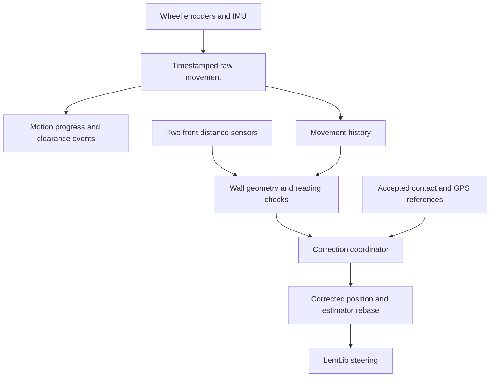

# RW-based localization and Skills motion plan

**Status: implementation proposal. This PR changes documentation only.**

Prepared on 2026-10-22 for an implementation agent. The goal is to reduce complete
Skills trip time and improve physical alignment at the existing drivetrain
limits. No time saving or localization improvement is established by this plan.

Read this document, then follow [the verification plan](rw_localization_motion_validation.md).
Implement the work packages in separate, reviewable commits. Keep experimental
behavior disabled in the normal build until the relevant checks pass.

## Source baseline

- Robot repository: [`7d2b586217b4c23d7d8e5d1062d43c6ec80e32bf`][robot-base].
- RW-Template: release **4.0.0**, commit
  [`5f574c071842b9cd389c72e13cbeb01ad039d289`][rw-base].
- Robot runtime: PROS 4.2.2 and LemLib 0.5.6.
- Existing instructions: [CLAUDE.md](../CLAUDE.md). Some historical descriptions
  there and in [skills_optimization.md](skills_optimization.md) precede the
  current source. Check current code and the [Skills journal](../journal/skills.md).

Fetch main again before implementation. If behavior changed, update this
baseline and the relevant tests first. Do not restore an older route merely to
make an old test or document agree with it.

### Current behavior to preserve

| Area | Current baseline |
| --- | --- |
| Sensors | IMU and drive-motor encoders; no passive tracking wheels. Two distance sensors on ports 1 and 3 both face forward. |
| Dimensions | Nominal chassis 16 by 12 inches. Claw is at the rear. Attachments and the rear cut-out need separate clearance checks. |
| Skills limits | Normal calm drive command 60; calm turn command 50. Audit each call's actual limit, including existing exceptions. Do not increase any limit. |
| G3 route | `kG3Diagonal = true`: direct line-up to G3 and direct return. The older G3Lane quarter-circle proposal is obsolete for this route. |
| Loader geometry | Line-up `(-48, -59.25)`; overdrive target `(-66, -63.15)`; expected contact X `-58.6`; curve lead `0.5`. These are field-frame coordinates. |
| Pickup | Loader dwell 150 ms; stall observation 100 ms; lift clearance 40 degrees. Lift and arm start toward scoring height at the clamp. |
| Mechanisms | `kStackWaitMs = 4000`, `kStackGates = false`; high arm raises use 2500 ms. Current pickup/release continuation policies are intentional. Instrument them without silently changing them. |
| Goal departure | Preserve the initial six inches of straight goal clearance and the existing mechanism handoff there. |
| Localization | A south-wall reading corrects field Y / route X. Loader and goal contacts provide other references. GPS automatic correction currently requires no active chassis motion. |

Sources: [hardware][hardware], [route constants][route-constants],
[mechanism policy][mechanism-policy], [current trip sequence][trip-sequence],
and [GPS correction gate][gps-gate].

## Selective adoption

Keep the current PROS application and LemLib motion executor. Use small modules
with explicit interfaces. Do not add another task that writes drivetrain motors
while a LemLib motion still owns them.

| RW part | Adopt or adapt | Do not copy without changes |
| --- | --- | --- |
| Raw movement counters in `motor-control.cpp` | Separate movement progress from corrected map position. | Global motion state without per-motion IDs. |
| `utils.cpp`: wall geometry | Individual sensor offsets, wall selection, ambiguity checks. | Four cardinal sensor roles, centered field coordinates, or relaxed defaults. |
| `runMcl()` history | Delay-aware measurement handling and bounded history. | VEXcode timestamp calls in PROS, or a fixed delay treated as measured fact. |
| Async wait helpers | Distance, turn, and proximity events. | A returned `void` wait interpreted as successful arrival. |
| `path.cpp`: profile/path math | Feasible acceleration, braking, and curvature limits. | A center-speed limit interpreted as a final wheel-output limit. |
| `path-following.cpp` | Feedforward calibration and selected controller ideas. | Hard-coded 12 V limits, VEXcode tasks, or timetable completion interpreted as arrival. |
| `mcl.cpp` | Possible later experiment after sensor coverage is measured. | Immediate MCL activation or removal of all scheduled resets. |

RW is MIT-licensed. Retain its notice and source attribution if code is copied
or substantially adapted. Pin the copied version. [RW license][rw-license].

## Intended structure



Raw movement remains an estimate. Wheel spin can still overstate ground travel.
A map correction must add no movement to a clearance counter. Distance along a
curve is also not a substitute for the existing straight clearance segment.

## P0. Capture a useful baseline

**Edit points:** `src/autons.cpp`, `src/motion_tune.cpp`, and the existing Brain
report helpers. Keep the existing `SKILLS_PHASE` output compatible.

- [ ] Record the base commit, route settings, command limits, and experiment
  switches with every run.
- [ ] Separate wall sampling time from reset alignment turns, repositioning,
  and heading touch-ups. Existing `wall_ms` is not the entire reset sequence.
- [ ] Record mechanism position and worker state when a wait ends. Preserve
  current continuation behavior; a deadline is not evidence of readiness.
- [ ] Keep failed pickups, scores, and aborted trips in the report.
- [ ] Make the tuner hold the tested route's command limits fixed. Its current
  curve sweep uses 80/110, some chain calls use default limits, and its endpoint
  metric uses odometry only. Do not use it unchanged for this comparison.

The full route has 13 wall-reset calls: eight before loader entry and five
before G3. Six successful polls span 0..50 ms, or about 0.65 seconds of requested
sampling delay across 13 clean batches. Retries and movement around the reset
are additional costs. Timeouts are ceilings, not fixed sleeps. [Sampling][wall-sampling].

**Exit:** baseline timing labels and results are interpretable. There is no
claim of speed improvement yet. See [baseline checks](rw_localization_motion_validation.md#baseline-checks).

## P1. Make motion progress and outcomes explicit

**Suggested modules:** `include/motion_progress.hpp`, `src/motion_progress.cpp`,
`include/skills_motion.hpp`, and `src/skills_motion.cpp`. These paths are proposals,
not files delivered by this documentation PR. Keep pure math separate from PROS
device access so tests can exercise production logic on the host.

### Movement source

- [ ] Record signed left/right wheel increments and IMU rotation with actual
  sample times. Use the robot's real wheel/gearing configuration.
- [ ] Compute center movement with turn compensation. Do not average absolute
  wheel distances: a pure turn must not create forward clearance.
- [ ] Keep a bounded movement history and accumulated travel independent of
  `chassis.getPose()` corrections. Use the same raw stream for progress and
  delayed-measurement compensation.
- [ ] Normalize PROS error values, nonfinite readings, encoder reset/disconnect
  jumps, and invalid time intervals before calculating movement. Invalidate or
  reseed bad samples; do not turn them into clearance.
- [ ] Give each route run and motion a generation/ID. Capture start time and
  progress only after that motion acquires ownership. An old waiter cannot
  attach to a successor motion.
- [ ] Audit all `waitUntil()` callers reachable while moving corrections are
  enabled. Limit initial application to the Skills match-load phase; do not
  accidentally enable it during the three-pin opening or other routes.

RW's separate counters are the useful pattern. LemLib 0.5.6 currently adds
changes in corrected pose to its internal distance counter. A local observer
can replace application event waits without replacing every motion controller.
Do not patch declarations while continuing to link an unchanged binary library.
[RW counters][rw-progress], [LemLib progress][lemlib-progress].

### Outcome contract

Keep these two results separate:

| Result | Allowed values or evidence |
| --- | --- |
| Observed stop cause | Wrapper deadline, requested cancellation, observed low wheel speed, sensor fault, or library ended with unknown cause. |
| Event state | Pending, predicate reached, ended without reaching it, or invalidated by a new run/motion. |

`isInMotion() == false` does not distinguish LemLib's internal timeout, settling,
or early exit. Return unknown unless a source hook exposes the true cause.
Starting inside an early-exit region is a separate case to test.

A contact result is a **contact candidate** based on low wheel speed plus the
expected approach region, heading, active command, and observation duration.
It is not proof from a dedicated contact switch. A deadline or stopping short
alone must not acquire the stronger contact label. Initially log the stronger
classification beside the existing route policy; change reference policy only
as a separately tested option.

### Ownership and stopping

- [ ] A controller has one drivetrain owner. Account for queued motions before
  a custom controller starts. A queued LemLib command must not wake later and
  compete with it.
- [ ] On abort or mode change, terminate/join the old writer before the final
  brake command. The old loop must not overwrite that brake.
- [ ] A rolling handoff has a known successor that immediately takes ownership.
  Do not leave output active while unrelated route logic waits.
- [ ] Preserve the single lift-worker rule and existing arm/lift takeover logic.

**Exit:** the progress, outcome, and ownership tests in the verification plan
pass. Normal route policy remains unchanged.

## P2. Build a south-wall observer and a bounded fast-reset path

**Suggested modules:** `include/wall_localization_math.hpp`,
`include/wall_localization.hpp`, and `src/wall_localization.cpp`.

Use explicit modes: **OFF**, **OBSERVE**, and **APPLY**. Normal builds start OFF.
OFF disables the new observer/correction feature and retains the existing reset
behavior. A diagnostic build uses OBSERVE to log candidates without applying
corrections from the observer; existing resets remain active.

### Geometry and checks

- [ ] Describe each sensor with its own measured forward/lateral offset and
  facing angle. Both sensors face forward. Keep unknown mount measurements
  visibly unset; do not guess a lateral baseline.
- [ ] Start with the known south wall and the current 5-degree heading gate.
  General wall selection and wider angles are later experiments.
- [ ] Preserve range/error checks, pair agreement, sample scatter rejection,
  and the full 4-inch correction limit. Test the full innovation before
  smoothing; many small nudges must not bypass a rejected large correction.
- [ ] Make any confidence check range-aware. PROS documents distance confidence
  as meaningful only above 200 mm; the south-wall line-up can be closer than
  that. Do not reject all close readings with an unconditional confidence
  threshold. Retain the other reading checks. [PROS interface][pros-distance].
- [ ] For moving batches, compare compensated wall-coordinate estimates. Raw
  ranges can legitimately differ because of sensor offsets or motion.
- [ ] Retain the current stopped sampler and its bounded retries as fallback.
  Do not silently replace paired observations with a single-sensor correction.

Use the current coordinate adapter, with explicit units and angle conventions:

```text
route_x = -4 - field_y
route_y = field_x + 63
field_heading_deg = route_heading_deg + 90   (wrapped)
south_wall_field_y = -70.63
```

A south-wall observation changes route X only. Preserve route Y and heading.
Do not pass route coordinates directly to RW's centered square-wall model.
Sources: [frame conversion][frame], [current wall limits][wall-limits],
[RW geometry][rw-geometry].

### Measurement age

- [ ] Store polling time, assumed latency, latency uncertainty, and generation.
  Polling time is not the physical measurement time.
- [ ] Use actual timestamps in the movement history. Estimate the pose at
  measurement time and propagate the observed coordinate forward.
- [ ] Rate-limit measurement use to the sensor cadence. A 10-ms poll is not
  proof of a new reading. Equal consecutive values do not prove staleness.
- [ ] Reject missing history, excessive timing uncertainty, rapid rotation,
  invalid readings, or a generation mismatch with explicit reasons.
- [ ] Treat RW's 40-ms delay as an initial hypothesis for OBSERVE, not a
  measured robot calibration. Record timing assumptions with every result.

The checked-in PROS distance interface does not provide RW's VEXcode
`.timestamp()` method. Use a supported adapter and conservative uncertainty;
do not invent a precision that the sensor interface cannot supply.
[RW history][rw-history], [PROS interface][pros-distance].

### First use on the route

Observe the south-facing G2 return while retaining every existing reset.
Compare the predicted correction with the later stopped reset and an independent
physical reference. Record which wall/axis is observable and why readings fail.

Then allow a stopped reset to consume a qualified recent observation without
another sampling wait. The observation must remain valid after the latest
relevant turn/contact and at the current pose. If not, execute the original
bounded reset. This can reduce sampling delay without enabling moving pose
writes. It does not by itself remove an alignment turn.

**Exit:** pure geometry/timing tests pass; OBSERVE never writes pose; the stopped
fast path preserves existing correction limits and fallback behavior.

## P3. Integrate moving corrections without estimator feedback errors

This package depends on P1/P2. It is a separate opt-in experiment.

- [ ] Use one correction coordinator for experimental wall corrections,
  accepted GPS corrections, loader/goal references, and route-start anchors in
  the enabled scope. Identify source, axis, generation, and correction amount.
- [ ] A new route or trusted contact anchor invalidates older observations.
  Do not replay pre-anchor sensor data onto the new pose.
- [ ] Update every pose-delta consumer. The GPS estimator also computes motion
  from changes in LemLib pose. Small wall nudges can be counted as movement
  there even when its teleport check does not trigger. Feed it raw increments
  or rebase it consistently with each committed correction.
- [ ] Specify and implement synchronization with LemLib's odometry update.
  A mutex used only by application tasks does not protect the library's
  internal read/modify/write. A suitable option is a small, pinned odometry
  hook that commits queued corrections at the update boundary and exposes a
  coherent correction sequence to dependent estimators.
- [ ] If a library hook is used, provide the pinned patch, reproducible build,
  license notice, and evidence that the linked library contains it. Do not link
  original and replacement definitions together.
- [ ] Test that the current unobserved coordinate and heading survive, movement
  is not lost or doubled, and the GPS estimator consumes each correction once.
- [ ] If consistent application is not implemented, keep moving APPLY unavailable.
  Finish the observer, stopped fast-reset, and independent route experiments;
  report this dependency rather than enabling an unsynchronized approximation.

Sources: [GPS movement calculation][gps-motion], [GPS rebase][gps-rebase], and
[LemLib odometry update][lemlib-odom].

Enable initial moving APPLY only in a documented clean south-facing G2-return
window. Keep the existing stopped resets as fallback. Remove a scheduled stop
only after the verification plan shows equivalent physical alignment and useful
time savings. A small filter spread or an earlier good reading is insufficient.

## P4. Test route geometry at unchanged limits

Each candidate has its own disabled-by-default switch and the current route as
fallback. P4 does not require full MCL. Use existing LemLib motion primitives
where they provide the necessary geometry and completion behavior.

### P4a. First four G3 returns: arrive facing south

- [ ] Construct the return from the actual starting pose. A goal reference may
  have been rejected; do not assume a perfect release location.
- [ ] Preserve the first six inches of straight departure. Start the existing
  mechanism return at that event. A curve cannot provide this clearance by
  accumulating six inches of path length.
- [ ] Bend only when the current lift/arm state fits the checked swept envelope.
  Otherwise use the current straight return and pivot.
- [ ] Arrive stopped at the existing line-up, facing south for its wall reset.
  Retain that reset and the loader entry initially.
- [ ] Apply only to the first four G3 returns. The fifth leads to the toggle;
  forcing south-facing arrival there does not remove its next turn.
- [ ] Compare return plus next alignment time, successful placements, and real
  clearance. A shorter centerline is not proof of a faster trip.

Do not reuse the old G3Lane quarter-circle coordinates. See [current trip][trip-sequence]
and [endgame][endgame].

### P4b. Loader entry: align before physical contact

The target at X = -66 is beyond expected contact at X = -58.6. For the current
reverse-west helper, `stage_x = -66 + straight_in`. Thus `straight_in > 7.4` is
necessary just to put staging before contact. Four inches of straight travel
before contact would require 11.4 inches from the target, not four.

That example stages at `(-54.6, -63.15)`, only about 7.66 inches from line-up.
LemLib enters its close-target mode inside 7.5 inches, leaving almost no space
for that short curve to remove the 3.9-inch lateral shift. Do not implement this
as a blind `straight_in` parameter change.

- [ ] Draw a path with enough alignment distance before actual contact.
- [ ] Check the full body and attachment envelope near the corner.
- [ ] Preserve the overall deadline, contact observer, dwell, and clamp order.
  The generic helper's blocking final leg does not supply loader contact exit.
- [ ] Preserve existing coordinates initially. Changes to contact calibration
  require physical evidence and a separate recorded comparison.

Sources: [loader constants][route-constants], [curve helper][curve-helper],
and [LemLib close-target behavior][lemlib-close].

### P4c. Park-entry handoff

Test only after checking the narrow grey-goal corridor. A spline or large
lookahead can cut inside a waypoint. Preserve the final stopping/contact
behavior. This is a lower-priority, once-per-run saving. [Park geometry][park].

## P5. Test profiles and drive calibration

Adapt portable math from `path.cpp` and the feedforward model from
`path-following.cpp`. Keep this controller experimental and give it exclusive
drivetrain ownership. Start with one repeatable departure or turn.

- [ ] Preserve the tested motion's existing final left/right command limits
  after feedforward, feedback, and steering. Log saturation duration.
- [ ] Keep command units and physical speed units distinct. LemLib's 60/127
  command is not RW's 60 inches/second.
- [ ] Plan feasible wheel speeds and accelerations for the curve, not only
  center speed. Final voltage saturation cannot make an infeasible timetable
  achievable.
- [ ] Measure drive response at permitted outputs. Do not run RW's stock
  calibration's higher voltage steps unchanged on this fixed-limit experiment.
- [ ] Use actual time deltas, handle reverse moves, and end by verified arrival
  or an explicit failure/deadline result. A timetable ending is not arrival.
- [ ] Compare low and raised payload states. Test braking and heading touch-up
  time as well as travel time. Keep the normal caps unchanged.

RW 4.0.0 has a verified equal-negative-output hole in its legacy `scaleToMax()`:
inputs (-24, -24) with cap 6 remain (-24, -24). Profile/path outputs instead cap
at 12 V. Neither is a drop-in implementation of this robot's limits.
[Legacy limiter][rw-cap], [profile output][rw-output].

## P6. Deferred options

Full MCL, general wall selection, larger sensor angles, a different sensor
orientation, an odometry replacement, and RAMSETE are separate decisions after
the earlier evidence exists. They are not required to finish P0-P5.

Two forward sensors observing one wall constrain one position axis in RW's
IMU-heading model. The loader approach can face an out-of-range wall; the G3
diagonal points the front pair toward a corner. Log actual coverage before
assuming continuous localization can remove those resets.

RW's MCL uses a local X/Y particle cloud, trusts IMU heading, and bounds its
corrections. Its supplied localization simulation uses four sensor directions
and a true-position controller. RW's full simulator does not model physical
goal/stack collisions or this robot's mechanisms. Passing those tests is useful
algorithm evidence, not proof of faster or reliable Skills on this robot.
[MCL][rw-mcl], [simulation][rw-sim], [simulator limits][rw-readme].

## Implementation handoff

Complete P0/P1 and the P2 observer first. Deliver their tests and Brain report
before enabling a route or localization experiment. Implement P3 only with the
required correction consistency. Test P4a next; treat P4b/P4c/P5 as independent
candidates. Do not combine several unmeasured changes into one time-saving claim.

At handoff, list implemented packages, enabled switches, exact build/test
commands, unresolved hardware measurements, and field results. Mark unrun
checks as pending. See the [verification and acceptance checklist](rw_localization_motion_validation.md).

[robot-base]: https://github.com/ShadowKingYT444/Goofy_Goobers_code_OVERRIDE/tree/7d2b586217b4c23d7d8e5d1062d43c6ec80e32bf
[rw-base]: https://github.com/richardbwang/RW-Template/tree/5f574c071842b9cd389c72e13cbeb01ad039d289
[hardware]: https://github.com/ShadowKingYT444/Goofy_Goobers_code_OVERRIDE/blob/7d2b586217b4c23d7d8e5d1062d43c6ec80e32bf/Lemlib/src/main.cpp#L67-L100
[route-constants]: https://github.com/ShadowKingYT444/Goofy_Goobers_code_OVERRIDE/blob/7d2b586217b4c23d7d8e5d1062d43c6ec80e32bf/Lemlib/src/autons.cpp#L1691-L1724
[mechanism-policy]: https://github.com/ShadowKingYT444/Goofy_Goobers_code_OVERRIDE/blob/7d2b586217b4c23d7d8e5d1062d43c6ec80e32bf/Lemlib/src/autons.cpp#L2200-L2259
[trip-sequence]: https://github.com/ShadowKingYT444/Goofy_Goobers_code_OVERRIDE/blob/7d2b586217b4c23d7d8e5d1062d43c6ec80e32bf/Lemlib/src/autons.cpp#L2737-L2769
[gps-gate]: https://github.com/ShadowKingYT444/Goofy_Goobers_code_OVERRIDE/blob/7d2b586217b4c23d7d8e5d1062d43c6ec80e32bf/Lemlib/include/gps_reset/gps_reset_impl.hpp#L446-L463
[rw-license]: https://github.com/richardbwang/RW-Template/blob/5f574c071842b9cd389c72e13cbeb01ad039d289/LICENSE
[wall-sampling]: https://github.com/ShadowKingYT444/Goofy_Goobers_code_OVERRIDE/blob/7d2b586217b4c23d7d8e5d1062d43c6ec80e32bf/Lemlib/src/autons.cpp#L2059-L2124
[rw-progress]: https://github.com/richardbwang/RW-Template/blob/5f574c071842b9cd389c72e13cbeb01ad039d289/src/motor-control.cpp#L1017-L1034
[lemlib-progress]: https://github.com/LemLib/LemLib/blob/v0.5.6/src/lemlib/chassis/motions/moveToPoint.cpp#L43-L49
[frame]: https://github.com/ShadowKingYT444/Goofy_Goobers_code_OVERRIDE/blob/7d2b586217b4c23d7d8e5d1062d43c6ec80e32bf/Lemlib/src/autons.cpp#L1660-L1675
[wall-limits]: https://github.com/ShadowKingYT444/Goofy_Goobers_code_OVERRIDE/blob/7d2b586217b4c23d7d8e5d1062d43c6ec80e32bf/Lemlib/src/autons.cpp#L2054-L2071
[rw-geometry]: https://github.com/richardbwang/RW-Template/blob/5f574c071842b9cd389c72e13cbeb01ad039d289/src/utils.cpp#L113-L163
[rw-history]: https://github.com/richardbwang/RW-Template/blob/5f574c071842b9cd389c72e13cbeb01ad039d289/src/motor-control.cpp#L1435-L1529
[pros-distance]: https://github.com/ShadowKingYT444/Goofy_Goobers_code_OVERRIDE/blob/7d2b586217b4c23d7d8e5d1062d43c6ec80e32bf/Lemlib/include/pros/distance.hpp#L64-L213
[gps-motion]: https://github.com/ShadowKingYT444/Goofy_Goobers_code_OVERRIDE/blob/7d2b586217b4c23d7d8e5d1062d43c6ec80e32bf/Lemlib/include/gps_reset/gps_reset_impl.hpp#L114-L138
[gps-rebase]: https://github.com/ShadowKingYT444/Goofy_Goobers_code_OVERRIDE/blob/7d2b586217b4c23d7d8e5d1062d43c6ec80e32bf/Lemlib/include/gps_reset/gps_reset_impl.hpp#L194-L199
[lemlib-odom]: https://github.com/LemLib/LemLib/blob/v0.5.6/src/lemlib/chassis/odom.cpp#L90-L185
[endgame]: https://github.com/ShadowKingYT444/Goofy_Goobers_code_OVERRIDE/blob/7d2b586217b4c23d7d8e5d1062d43c6ec80e32bf/Lemlib/src/autons.cpp#L2797-L2819
[curve-helper]: https://github.com/ShadowKingYT444/Goofy_Goobers_code_OVERRIDE/blob/7d2b586217b4c23d7d8e5d1062d43c6ec80e32bf/Lemlib/include/curve_motion.hpp#L49-L65
[lemlib-close]: https://github.com/LemLib/LemLib/blob/v0.5.6/src/lemlib/chassis/motions/moveToPose.cpp#L58-L67
[park]: https://github.com/ShadowKingYT444/Goofy_Goobers_code_OVERRIDE/blob/7d2b586217b4c23d7d8e5d1062d43c6ec80e32bf/Lemlib/src/autons.cpp#L1739-L1748
[rw-cap]: https://github.com/richardbwang/RW-Template/blob/5f574c071842b9cd389c72e13cbeb01ad039d289/src/motor-control.cpp#L160-L175
[rw-output]: https://github.com/richardbwang/RW-Template/blob/5f574c071842b9cd389c72e13cbeb01ad039d289/src/path-following.cpp#L71-L129
[rw-mcl]: https://github.com/richardbwang/RW-Template/blob/5f574c071842b9cd389c72e13cbeb01ad039d289/src/mcl.cpp
[rw-sim]: https://github.com/richardbwang/RW-Template/blob/5f574c071842b9cd389c72e13cbeb01ad039d289/tests/sim_mcl.cpp#L56-L150
[rw-readme]: https://github.com/richardbwang/RW-Template/blob/5f574c071842b9cd389c72e13cbeb01ad039d289/README.md#8-simulator
